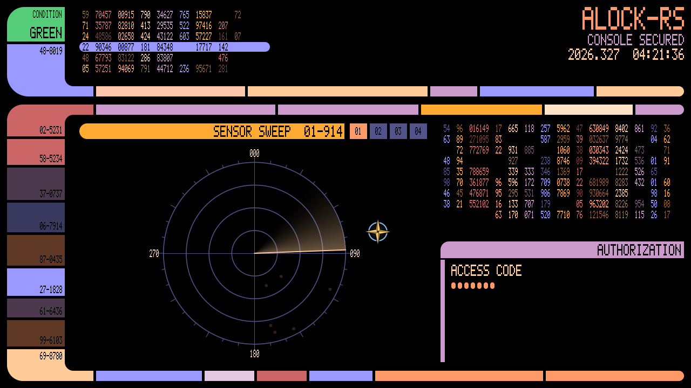

# alock-rs

A Rust rewrite of [alock](https://github.com/Arkq/alock) for X11. It keeps the
parts that were worth keeping, PAM, an image background and a custom
**alpha-transparent image cursor**, and adds an animated starship-console
lock screen that you can click.



```sh
# drop-in for the old alock line
xss-lock -- alock-rs -bg image:file=$HOME/.images/lock -cursor image:file=$HOME/.images/larry.png

# the console theme with the emblem cursor
xss-lock -- alock-rs -bg console -cursor emblem:pulse

# preview a theme safely (exits by itself after 20 s)
alock-rs -bg console:palette=blue -cursor emblem:size=64 -demo 20
```

The cursor is composited in software, so the hardware cursor plane never
holds alpha pixels. That is what fixes the stale desktop pixels NVIDIA
showed through alock's ARGB cursor after resume. Once the screen is locked,
the only ways out are a successful authentication and losing the X server.

## Documentation

- [Options](docs/options.md): `-auth`, `-bg`, `-cursor`, `-input`, colors and keys
- [Console theme](docs/console.md): what it shows and what you can click
- [Design](docs/design.md): the NVIDIA bleed-through, staying locked, writing a theme
- [Coming from alock](docs/alock.md): what was not carried over
- [Limitations](docs/limitations.md)

## Building

```sh
cargo build --release      # needs libpam
cargo test
```

For Gentoo, `contrib/alock-rs-9999.ebuild` is a live ebuild for the
oubliette overlay.

## Credits

alock-rs is a rewrite of [alock](https://github.com/Arkq/alock) by Mathias
Gumz and Arkadiusz Bokowy, MIT licensed like this project. See `LICENSE`.
